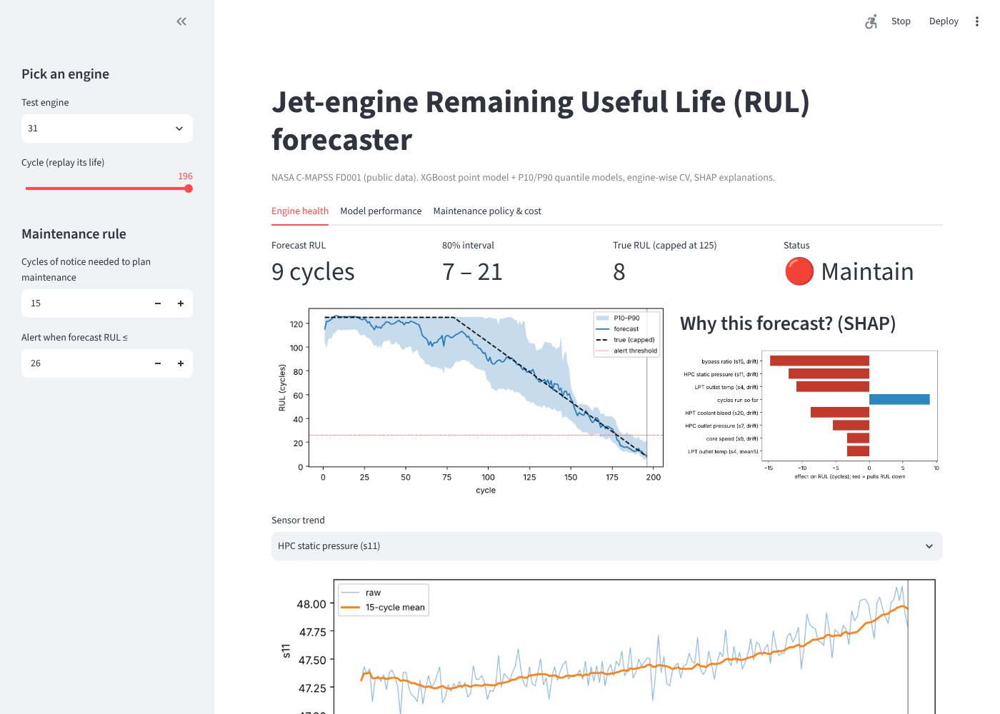

# Engine RUL Forecaster: predictive maintenance with uncertainty and a cost model

This project predicts the **Remaining Useful Life (RUL)** of turbofan engines from sensor history, gives an 80% prediction interval, explains each forecast with SHAP, and turns the forecast into a **maintenance decision** that is priced against a fixed-interval schedule.

Data: NASA **C-MAPSS FD001** (public, downloaded automatically on first run): 100 training engines run to failure, plus 100 test engines cut off at a random point with the true RUL given.



## Why it's more than "fit a regressor"

| Step | What I did | Why |
|---|---|---|
| Target | Piecewise-linear RUL capped at 125 cycles | Early in life, degradation is invisible; an uncapped target forces the model to guess noise |
| Features | Per-engine rolling mean (5/15/30), rolling std, 15-cycle slope, and **drift from the engine's own first-20-cycle baseline** (99 features, past-only) | Engines start with different offsets; drift removes unit-to-unit bias. A test checks there is no look-ahead |
| Validation | **GroupKFold by engine** for tuning (an engine never sits in both train and validation) | Row-wise CV leaks an engine's own future and makes scores look better than they are |
| Uncertainty | Separate XGBoost **quantile models** (P10, P90) | A maintenance planner needs "how sure", not one number |
| Metric | RMSE, MAE, and the **NASA PHM08 score** (late predictions punished more than early ones) | Predicting too late is a missed failure; too early only wastes life |
| Explainability | SHAP TreeExplainer per prediction | Shows which sensors are pulling RUL down for this engine |
| Decision | Replays every training engine cycle by cycle on **out-of-fold** predictions. Alert thresholds are tuned on 50 engines and **scored on the other 50** | It answers the business question rather than just the ML one |

## Results (`python train.py`, ~3–4 min on a laptop CPU)

**Official test set (100 engines, prediction at the last observed cycle):**

| Model | RMSE (cycles) | NASA score (lower = better) |
|---|---|---|
| Predict the training mean | 41.9 | 33,354 |
| Ridge on raw sensors | 20.8 | 1,251 |
| XGBoost on raw sensors | 17.0 | 909 |
| **XGBoost + time-series features, tuned** | **10.8** | **166** |

- MAE: 8.0 cycles.
- The P10–P90 interval covers **86%** of test engines (target: 80%). The average width is 32 cycles.
- 3 of 100 engines were predicted more than 20 cycles too late. Those 3 are where to look next.
- Engine-wise 5-fold CV RMSE was 8.8 for the best setting (depth 4, min_child_weight 20). The 6 settings in the grid ranged from 8.8 to 9.1.

**Maintenance policy (50 held-out engines; costs are assumptions, editable in the app):**

Assumptions: unplanned failure = 100, planned maintenance = 10, each cycle of life thrown away = 0.2, and 15 cycles of notice needed.

| Policy | Unplanned failures | Avg. life thrown away | Cost / engine |
|---|---|---|---|
| Fixed interval (best cycle, tuned) | 3 / 50 | 72 cycles | 29.0 |
| **Point forecast ≤ 26 cycles → maintain** | **0 / 50** | **11 cycles** | **12.2** |
| P10 forecast ≤ 19 cycles → maintain | 1 / 50 | 11 cycles | 13.9 |

Under these assumptions, forecast-based maintenance costs **~58% less** than a fixed schedule and avoided all failures on the held-out half. The pessimistic P10 rule did *not* win here: its tuned threshold was too tight and let one engine through. I report that as found.

## Run it

```bash
pip install -r requirements.txt
python train.py              # optional: retrains (~3-4 min), rewrites the *.json.gz models + metrics.json
streamlit run app.py         # interactive demo
pytest -q test_rul.py        # 6 tests (labels, no look-ahead, NASA score, policy logic, beats baseline, saved models load)
```

## Files

- `data.py`: load C-MAPSS, build RUL labels, drop constant sensors.
- `features.py`: rolling, slope and drift features (past-only).
- `model.py`: XGBoost point and quantile models, engine-wise tuning, NASA score, out-of-fold predictions.
- `policy.py`: maintenance simulation and cost comparison.
- `train.py`: end-to-end pipeline that writes the metrics.
- `point.json.gz`, `q10.json.gz`, `q90.json.gz`: trained models (XGBoost JSON); `meta.json`: feature list; `oof_train.csv.gz`: out-of-fold predictions; `metrics.json`: all results.
- `app.py`: Streamlit app with three tabs: engine health, model performance, and maintenance policy and cost.

## Limitations / next steps

- FD001 has one operating condition and one fault mode. FD002–FD004 (six conditions, two fault modes) would need per-condition normalisation.
- Sequence models (1D-CNN/LSTM over the last 30 cycles) are the usual next comparison. Here, gradient boosting with engineered features was already strong and easy to explain.
- Quantile models are trained separately, so P10 > P90 can occur in rare cases. Conformal prediction would give coverage guarantees.
- The cost model is illustrative. With real maintenance costs and lead times, the thresholds should be re-tuned.

*Data: NASA Prognostics Center of Excellence, "Turbofan Engine Degradation Simulation Data Set" (Saxena & Goebel, 2008), public.*
